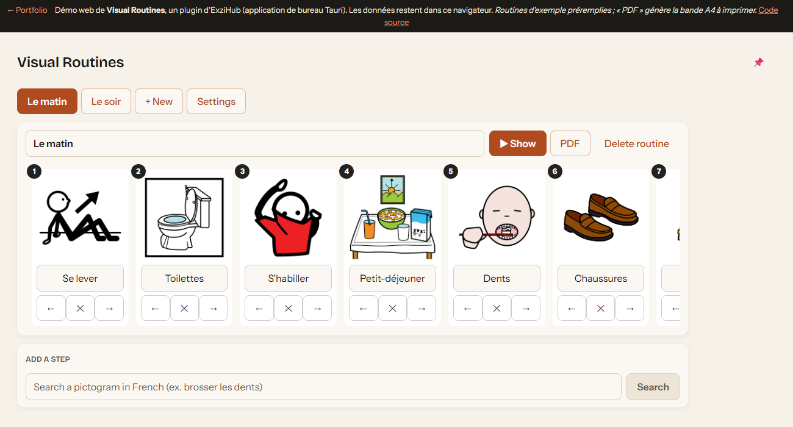

# Routines visuelles : des pictogrammes pour structurer la journée d'un enfant

**[▶ Essayer la démo](https://exzitech.github.io/routines-visuelles/)** · TypeScript · React · Canvas · PDF écrit à la main · API ARASAAC



Les routines en images (se lever, s'habiller, se brosser les dents...) aident
beaucoup d'enfants, en particulier ceux avec un TSA ou un TDAH. Les préparer à la
main (chercher les images, les découper, les plastifier) prend du temps. Cet
outil les fabrique en quelques clics.

## Ce que fait l'outil

- **Recherche de pictogrammes** en français dans la banque
  [ARASAAC](https://arasaac.org) (des milliers de pictogrammes libres, référence en
  communication alternative et améliorée).
- **Composition de la routine** : ajouter, renommer, réordonner les étapes.
- **Bande A4 à imprimer** : un PDF généré dans le navigateur, prêt à plastifier.
- **Vue « pas à pas » plein écran** pour le téléphone ou la tablette : l'enfant
  voit l'étape en cours, grand format, et avance d'un geste.
- **Synchronisation** entre appareils (dans l'application ExziHub, sur PC et Android,
  via Nextcloud) : préparé sur le PC, utilisé sur le téléphone.

## Points techniques

- **PDF sans bibliothèque.** La bande est dessinée dans un canvas, puis enveloppée
  dans un PDF minimal écrit octet par octet ([`src/pdf.ts`](plugins/routines/src/pdf.ts)),
  crédit ARASAAC imprimé. Aucune dépendance de plus, et tout se fait dans le navigateur.
- Structure du PDF testée automatiquement ([`tests/pdf.test.ts`](plugins/routines/tests/pdf.test.ts)).
- Recherche annulable (`AbortController`) : taper vite n'accumule pas les requêtes.
- Données versionnées et validées au chargement : un fichier corrompu donne une
  erreur explicite au lieu d'un écran cassé.

## Lancer en local

```
npm install
npm run dev
npm test
```

## Contexte

C'est l'un des plugins d'[ExziHub](https://github.com/Exzitech), une application
de bureau (Tauri) dont chaque outil s'installe à la demande. Il est né d'un besoin
réel à la maison, et il en tient compte : peu de clics, gros boutons, impression fiable.

## Licences

Code : MIT. Pictogrammes : auteur Sergio Palao, origine [ARASAAC](https://arasaac.org),
licence [CC BY-NC-SA 4.0](https://creativecommons.org/licenses/by-nc-sa/4.0/), propriété
du Gouvernement d'Aragon. Ils sont chargés depuis ARASAAC et ne sont pas
redistribués ici.
